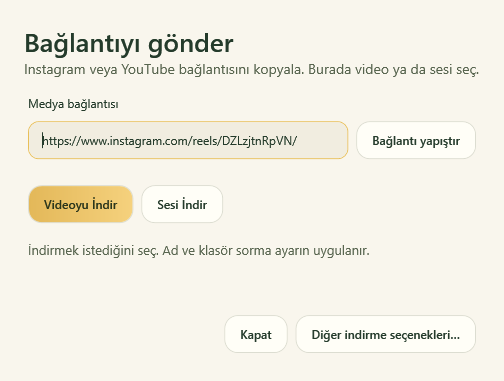
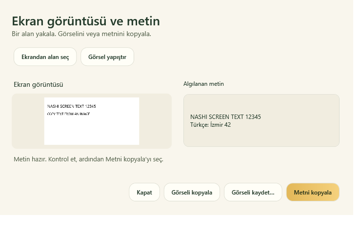
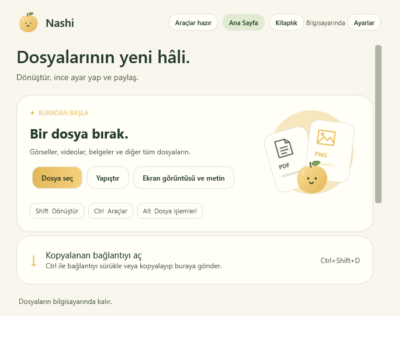
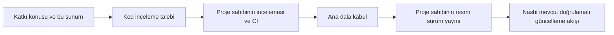

# Nashi — Windows medya ve ekran metni geliştirmeleri

**Katkı sunumu · 7 Kasım 2026 · Windows**

[Katkı konusu / proposal #776](https://github.com/orkunisitmak/nashi-app/issues/776)

## English overview

This contribution improves the Windows media-download workflow and adds local screenshot text capture. Explicit wheel choices start the chosen download; an optional confirmation asks for an editable media title and a one-time destination. Ctrl-dragged media links and the copied-link chooser share video/audio choices. Instagram poster/blob and narrowly verified pointer-only reel drags resolve to a single reel URL. A new screenshot window uses Windows OCR locally, preserves manual corrections, and copies text or saves PNG safely. Existing update verification, release signing and the macOS implementation are unchanged.

---

## 1 · Hangi sorunları çözüyoruz?

| Önce | Bu katkıyla |
| --- | --- |
| Çarktaki açık indirme seçimi tekrar biçim ekranına dönüyordu. | Video, ses veya küçük resim seçimi ilgili indirmeyi başlatıyor. |
| Her indirme için ad ve hedef klasör seçilemiyordu. | Özgün medya başlığıyla açılan ad/klasör penceresi isteğe bağlı kullanılabiliyor. |
| Instagram sürüklemesi bağlantı yerine kapak veya blob taşıyabiliyordu. | Gerçek bağlantı öncelikli tutuluyor; uygun Reel hareketinde sayfa adresi çözümleniyor. |
| Kopyalanan bağlantıdan indirme çok sayıda seçenek arasından yürüyordu. | Ana ekrandaki “Kopyalanan bağlantıyı aç” doğrudan video/ses seçimine götürüyor. |
| Görüntüdeki kopyalanamayan metinler yeniden yazılıyordu. | Ekran alanındaki veya yapıştırılan görüntüdeki metin yerel olarak okunup kopyalanabiliyor. |

## 2 · Bir bağlantı, iki giriş

**Sürükle:** Instagram Reel veya YouTube bağlantısı → **Ctrl ile sürükle** → **Videoyu indir / Sesi indir** üzerine bırak.

**Kopyala → gönder:** Bağlantıyı kopyala → Nashi’de **Kopyalanan bağlantıyı aç** veya **Ctrl+Shift+D** → adresi kontrol et/düzenle → video ya da sesi seç.

İki giriş aynı seçenek listesini ve indirme akışını kullanır. YouTube küçük resimleri ve Instagram fotoğraf seçimi korunur. “Diğer indirme seçenekleri…” mevcut kalite ve fotoğraf ekranını açar. Önceki Shift hareketi de kullanılabilir.



*Nashi’nin kendi WPF penceresinin kontrollü görüntüsü; web sayfası veya kişisel dosya gösterilmez.*

## 3 · Başlık ve kayıt yeri kullanıcının kontrolünde

**Ayarlar → Klasörler → Medya indirmeden önce ad ve klasör sor** başlangıçta açıktır.

- Açıkken özgün medya başlığı düzenlenebilir ad olarak gelir; yalnızca o indirme için klasör seçilir.
- Kapalıyken seçilen medya kayıtlı indirme klasörüne doğrudan indirilir.
- Geç gelen başlık kullanıcının yazdığı adı değiştirmez. Başlık alınamazsa elle ad girilebilir.
- Gerçek dosya uzantısı ve Unicode korunur. Mevcut dosyalar ezilmez; çakışan ad numaralandırılır.
- Kaydetme iptal edilirse indirme başlamaz. Başka işlem sürerken bağlantı penceresi adresi korur ve seçeneklerini bekletir.

## 4 · Ekran görüntüsünden düzenlenebilir metin

**Ctrl+Alt+S** → alan seç → görüntüyü ve okunan metni yan yana incele → gerekirse düzelt → **Metni kopyala**.

Ana ekran ve tepsi menüsündeki **Ekran görüntüsü ve metin** penceresi hazır görüntü yapıştırmayı, görüntüyü kopyalamayı ve PNG kaydetmeyi de destekler. Esc/sağ tık seçimden çıkar; Enter tüm yakalamayı seçer. Geç gelen tanıma sonucu elle yapılan düzeltmeyi silmez.



*Örnek görüntü ve metin sentetiktir. Tanıma Windows OCR ile bilgisayarda yapılır; ekran görüntüsü bir hizmete yüklenmez.*

## 5 · Mevcut Nashi tasarımına uyum

Türkçe/İngilizce metinler, açık/koyu görünüm, mevcut renkler, Segoe UI ve altın birincil düğmeler kullanılır. Ana ekrandaki bağlantı girişi, en yeni ana dalın tek kart biçimindeki düğme stilini korur. Durum mesajları nazik erişilebilirlik bildirimleri sunar.



*Kontrollü ana ekran görüntüsü; kişisel dosya veya indirme geçmişi içermez.*

## 6 · Doğrulama ve sınırlar

| Alan | Kanıt |
| --- | --- |
| Ortak motor ve güvenli dışa aktarma | Gönderim dalında `Nashi.Verify`: **1.924 başarılı kontrol**. |
| Kopyalanan bağlantı ve Ctrl bırakma | 35 kontrol: ortak seçenekler, adres önceliği, geçersiz/meşgul pano, pencere kullanımı, işlem sırasında koruma, iptal ve gerçek dosya indirme. |
| Ekran görüntüsü, OCR ve Reel hareketi | 47 kontrol: gerçek sentetik pencere yakalama, Windows OCR, metin düzenleme, güvenli PNG, kısayol, çözümleme ve bağlantı taşımayan çark seçimi. |
| Ad/klasör penceresi | Önceki yerel uygulamada 25 pencere, davranış ve erişilebilirlik kontrolü başarılıydı; gönderim hazırlığında bu paket yeniden çalıştırılmadı. |
| Görsel kontrol | Ana ekran: iki durum × iki tema × iki dil; seçim ve OCR pencereleri ayrıca incelendi. |
| Gerçek Instagram medya dosyası | Yaklaşık 74 saniyelik tek MP4 içinde video ve ses doğrulandı; gerçek görüntü karesi çözümlendi. |

Kontrollü WPF bırakma olayları fiziksel Instagram tarayıcı sürüklemesinin yerine geçmez. Gerçek tarayıcı hareketi, farklı ölçekli çoklu monitör ve ekran okuyucunun konuşması bağımsız olarak doğrulanmış sayılmaz. Önceki genel Explorer fare testleri etkin masaüstünde aralıklı hata verdi; tüm masaüstü testlerinin geçtiği iddia edilmez. Instagram’ın oturum veya erişim kısıtları için başarı garantisi verilmez; çerez ya da oturum içe aktarma eklenmez.

## 7 · Repodan resmî güncellemeye



Bu katkı güncelleme adreslerini, güvenilen anahtarları, imza kontrollerini veya sürüm yayınlama yetkisini değiştirmez. Bir fork veya CI çıktısı resmî güncelleme değildir. Değişiklikler kabul edilip proje sahibi resmî sürüm yayımladığında mevcut güncelleme sistemi kullanılabilir.

## Yeniden çalıştırma

```powershell
dotnet run --project windows/Nashi.Verify -c Release
dotnet publish windows/Nashi.Windows -c Release -o build/windows/Nashi

# Her çalışma için ayrı bir tanılama klasörü seçin.
$env:NASHI_SMOKE_DIRECTORY = 'D:\Nashi-checks\links-run-1'
.\build\windows\Nashi\Nashi.exe --smoke-test-links
$env:NASHI_SMOKE_DIRECTORY = 'D:\Nashi-checks\capture-run-1'
.\build\windows\Nashi\Nashi.exe --smoke-test-capture
```

Genel kısayol kaydı denemesi için başka bir Nashi süreci açık olmamalıdır. Yerel görüntü denetimleri ve bu sunumun resimleri kişisel dosyalar yerine kontrollü örnekler kullanır. Bu katkının uygulama kodu Windows kapsamındadır; macOS üzerinde yeni özellik veya test başarısı iddia edilmez.
