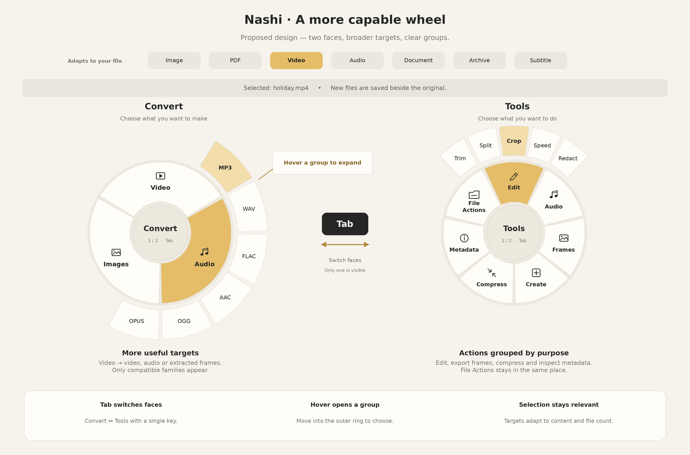
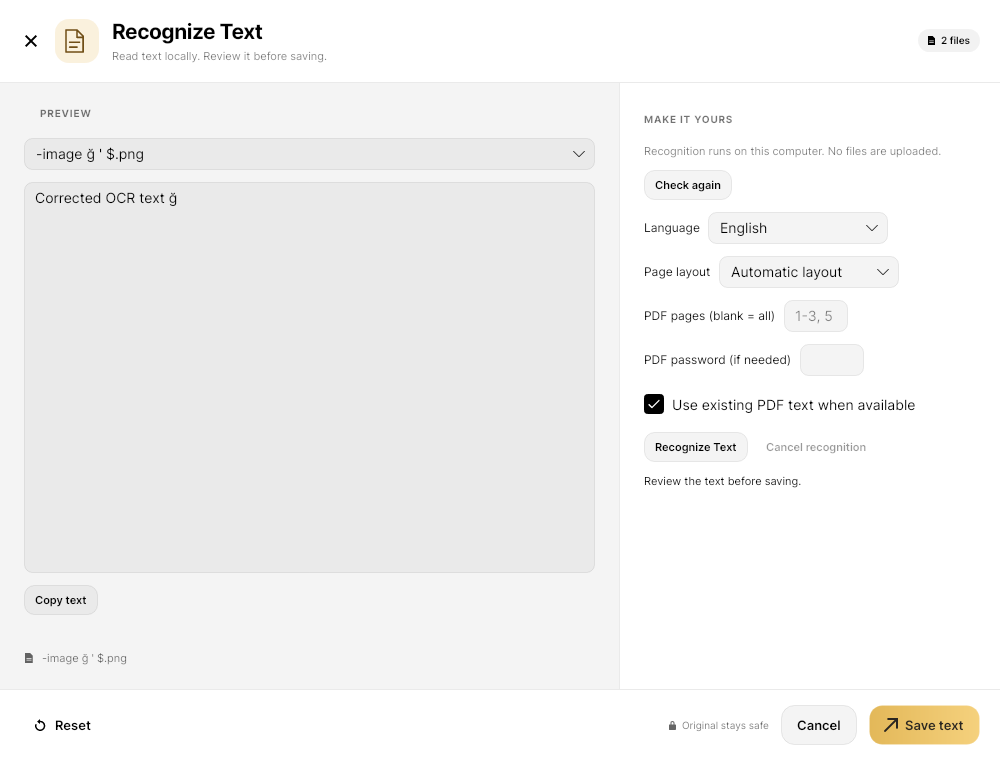
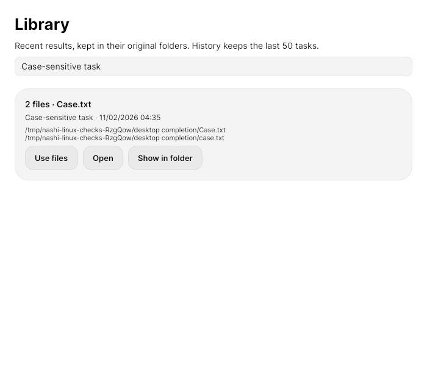
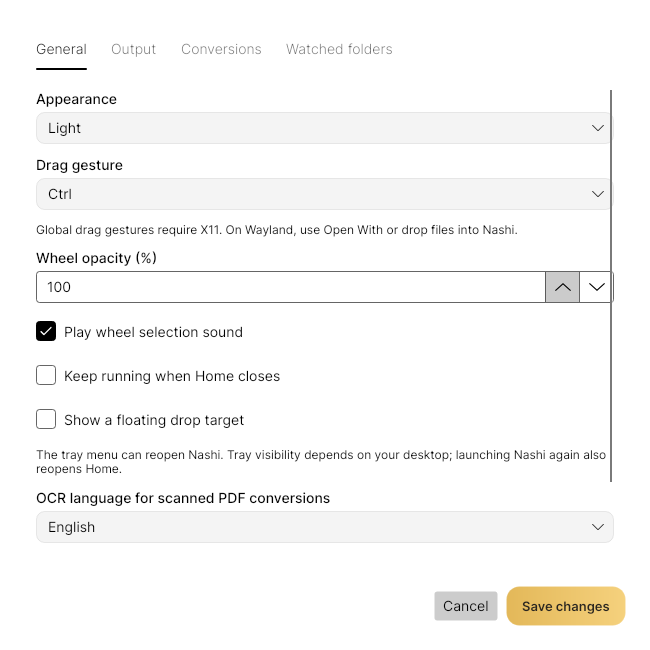

# Nashi for Linux

**Convert, edit and organize files from a radial menu.**

Linux v1 preview · x86_64 AppImage · X11 recommended

[Installation](#installation) · [Features](#what-you-can-do) · [Linux vs macOS](#linux-vs-macos) · [Detailed guide](GUIDE.md) · [Türkçe](README.tr.md)

> **First Linux edition — detailed testing is ongoing.** The current application version is **0.7.14**. “Linux v1” refers to this first Linux edition. Distribution, desktop and codec compatibility are still being tested.

## Two faces. One workflow.

| Convert | Tools |
| :---: | :---: |
|  |  |
| Choose an output format. | Choose an editing or file operation. |

*Example renders from the Linux UI checks: a PDF selection on the left, a media selection on the right. Available groups depend on your files.*

**Tab** switches faces. **Hover** over a group to expand its outer ring. **Select or drop** on an option to run it or open its editor. Full action names appear below the wheel.

Mixed selections now offer shared targets first. For example, an image and a PDF can both become JPG; a target that applies to only some files shows its scope below the wheel, such as **WEBP · 1 of 3 files**. Only those files are processed; originals stay unchanged.

<details>
<summary>View the original two-face design plan</summary>



*Design reference; exact labels and available options vary in the current app.*

</details>

## Installation

Download the AppImage and matching `.sha256` file from a [release containing Linux assets](https://github.com/orkunisitmak/nashi-app/releases), or the **Linux preview** artifact from the [Linux build workflow](../.github/workflows/linux.yml). Linux release assets may not yet be published. Preview packages are unsigned.

```sh
sha256sum -c Nashi-Linux-x86_64.AppImage.sha256
chmod +x Nashi-Linux-x86_64.AppImage
./Nashi-Linux-x86_64.AppImage
```

The .NET runtime is included. If FUSE mounting fails, run with `--appimage-extract-and-run`. On Ubuntu 22.04, normal mounting can use `libfuse2`.

### Extra tools

Install only what your operations need. Image processing and PDF libraries are bundled. Use the pinned FFmpeg 9 tool setup for full media support; older distribution builds can lack required filters (for example, Ubuntu 22.04’s FFmpeg 4.4 cannot export frames with the current engine).

| Tool | Used for | Install |
| --- | --- | --- |
| FFmpeg + ffprobe | Audio, video and frame export | In-app **Set up tools**, or system `ffmpeg` |
| LibreOffice | Office and document conversion routes | Native distribution package; not Snap/Flatpak |
| ExifTool + Perl | Image/PDF metadata | ExifTool through setup; system `perl` |
| Deno | Pages conversion | In-app tool setup |
| Tesseract + language packs | Local OCR for images and scanned PDFs | System `tesseract-ocr`, `tesseract-ocr-eng`, `tesseract-ocr-tur` packages |
| PulseAudio / PipeWire compatibility | Preview and feedback audio | Desktop audio service |

Ubuntu/Debian example: `sudo apt install ffmpeg libreoffice perl`. See the [setup guide](GUIDE.md#required-and-optional-components) for details.

### Use it from your desktop

Place the AppImage in a permanent location, then run:

```sh
./Nashi-Linux-x86_64.AppImage --install-integration
```

This enables login autostart, **Ctrl-drag on X11**, and **Open With → Nashi**. It adds no Nautilus Scripts entries and cleans up the old Nashi scripts.

This Avalonia build requires XWayland in Wayland sessions. On Wayland, use Open With or the app; global Ctrl-drag is unavailable. Inside Nashi, choose or drop files, paste copied files with **Ctrl+V**, and open the wheel with **Ctrl+Space**.

## What you can do

| Files | Main capabilities |
| --- | --- |
| Images | Convert, crop, resize, rotate, adjust colours, annotate, redact, add backgrounds, create collages, compress, edit metadata and read QR codes |
| PDF | Export JPG/PNG pages, extract existing text, reorder/split/merge pages, compress, edit metadata and create PDFs from images |
| Documents & data | Convert compatible Office, Pages, EPUB, HTML, Markdown, text and spreadsheet formats |
| Video | Convert, trim, split, crop, change speed, redact, mute, join, compress, extract audio and export frames |
| Audio | Convert, trim, normalize loudness, adjust channels, bleep ranges and create visualizations |
| Archives & subtitles | Extract ZIP/TAR/GZIP/RAR; supported archive creation and SRT/VTT/text conversion |
| File actions & Float | Copy, move, copy paths, open a terminal, reveal files and keep file references on a floating shelf |

**OCR:** Tools → Read → OCR recognizes images and PDF pages locally. Select English/Turkish and a page layout, review or edit the result, then copy it or save TXT. Tesseract 5 is recommended; compatible Tesseract 4 LSTM installations also work. See [OCR setup and limits](OCR-OPTIONS.md).

<details>
<summary>OCR editor preview</summary>



*UI test render showing reviewed text and recognition controls.*

</details>

**By default, outputs go beside the original.** A PDF in Downloads produces its JPG pages in Downloads. Originals are preserved, existing names receive unique alternatives, and the result card offers **Show in folder**. Combining operations save beside the first input; unwritable folders prompt for another destination. Settings can instead ask once per task or use a fixed output folder.

See the [format list and tool details](GUIDE.md#formats-and-capabilities) for supported inputs, targets and restrictions.

## Desktop workflows

- **Library:** search the last 50 completed tasks, reopen their results or reuse them in a new selection. History references the real output folders; missing files are marked.
- **Settings:** choose output behavior, appearance, X11 gesture, OCR language and format defaults. Configure watched folders without editing JSON.
- **Clipboard:** paste files/folders, text, PNG images or a public link. Pasted links open a download screen; nothing downloads until you choose **Download**.
- **Folders:** add, drop or paste folders, pack them with files into ZIP, or copy/move them. Folder copy rejects links, nested destinations and batches above 4 GB/10,000 items. Cross-filesystem folder moves can fail and leave originals in place.
- **Background access:** a tray menu reopens Home and Float. An optional floating drop target accepts files on desktops where global gestures are unavailable; real Wayland coverage remains pending.

```sh
./Nashi-Linux-x86_64.AppImage convert /path/report.pdf --to jpg
./Nashi-Linux-x86_64.AppImage ocr /path/scan.pdf --language eng+tur
./Nashi-Linux-x86_64.AppImage --help
```

Desktop integration also adds `~/.local/bin/nashi` when that name is free or already managed by Nashi. Existing third-party commands are preserved. x64 DEB and RPM preview builders are also available; package-manager installation is still untested. The optional [portable archive](scripts/build-linux-portable.sh) includes a per-user installer that keeps the previous installation as a backup; no system installation is needed to run the archive.

<details>
<summary>Library and Settings previews</summary>




</details>

## Linux vs macOS

This compares the current repository implementations. Similar tools do not imply identical native behavior or full feature parity.

| Area | Linux v1 preview | macOS |
| --- | --- | --- |
| Application | .NET / Avalonia, self-contained AppImage | Native Swift / AppKit app |
| Drag workflow | Ctrl-drag on X11; two faces switched with Tab; Wayland uses app/Open With or the optional drop target | Configurable native drag shortcuts for conversion, tools and actions |
| Image editing | Core editing tools; HEIC input and FFmpeg-backed HEIC export | Core editing tools plus HEIC export |
| Automatic detection | Local OCR word regions for reviewed redaction; plain-background removal; no face detection | Vision-assisted face/text detection in redaction |
| Scanned PDFs | Local Tesseract OCR; reviewed TXT and automatic scanned-page text in TXT/Markdown/editable document conversions | Vision OCR for scanned-page text extraction |
| Document tools | System LibreOffice; Deno for Pages; fewer conversion-option controls | Optional office runtime and native PDF processing; layout/password options |
| HTML → PDF | Sanitized HTML via LibreOffice; no script execution | Local WebKit rendering supports script-drawn content, with remote resources blocked |
| Media tools | FFmpeg-based conversion/editors and previews | Media tools with native platform playback |
| Library & general preview | Persistent searchable task history, reuse, external Open and editor previews; no general batch preview | Persistent Library and file/batch preview |
| Clipboard | Files/folders, private text/PNG imports and links to the download screen | Files/folders, text, images and links |
| Web downloads | Public-link download UI for video, audio, images, photos and thumbnails | Dedicated public-link download workflow |
| Sharing | Reveal files in the file manager | Native sharing and AirDrop |
| Window arrangement | Not available | Drag-based window layouts |
| Settings & updates | Settings UI, format defaults, watched folders and tray menu; no automatic updater | Settings UI and Sparkle updates |

For the broader desktop comparison, see [desktop parity](../docs/DESKTOP-PARITY.md), which documents macOS and Windows separately.

## Status and verification

Development and native drag/drop testing have been performed on **Ubuntu 22.04.5 / X11**. Detailed tests continue across real files, codecs and desktop configurations.

On 2026-11-02, local verification passed **4,878 Linux checks** and **2,285 shared-engine checks including real media**, using pinned FFmpeg 9, Deno and ExifTool plus system LibreOffice. All **380 offered conversion routes** ran, including Pages, and the metadata round trip passed. The native X11 check verifies PDF → JPG drag/drop, output location and source integrity. One initial hover timeout was followed by four successful reruns, including three consecutive runs; its intermittent cause remains unresolved. These results do not establish compatibility with every file or distribution. The ARM64 desktop-smoke job is prepared but has not yet run remotely; ARM64 is experimental and bundled tool downloads remain x64-only.

[Build and test commands](GUIDE.md#build-and-verify) · [Known limitations](GUIDE.md#preview-limits-and-testing-status) · [Integration and preferences](GUIDE.md#desktop-integration-ctrl-drag-and-open-with)

For bug reports, include the application version, distribution, X11/Wayland session, source/target formats and error message.
