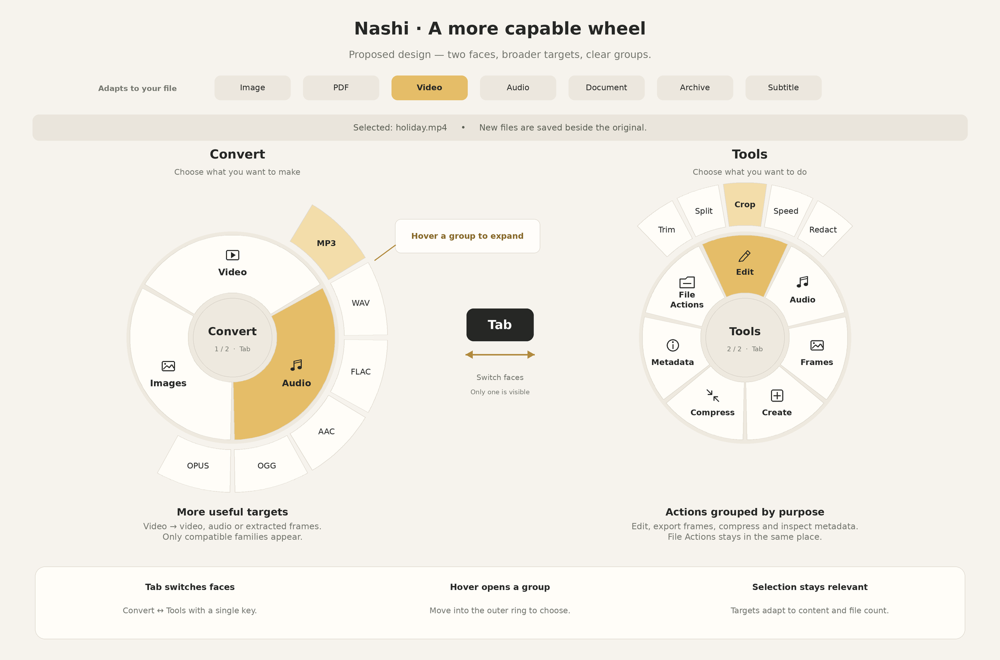

# Linux için Nashi

**Dosyaları tekerlek menüsünden dönüştürün, düzenleyin ve yönetin.**

Linux v1 önizleme · x86_64 AppImage · X11 önerilir

[Kurulum](#kurulum) · [Yetenekler](#neler-yapabilir) · [Linux ve macOS](#linux-ve-macos) · [Ayrıntılı rehber](GUIDE.tr.md) · [English](README.md)

> **İlk Linux sürümü — ayrıntılı testler devam ediyor.** Uygulama sürümü **0.7.12**; “Linux v1” ilk Linux sürümünü ifade eder. Dağıtım, masaüstü ve codec uyumluluğu hâlâ test ediliyor.

## İki yüz, tek akış

| Convert | Tools |
| :---: | :---: |
|  |  |
| Çıktı biçimini seçin. | Düzenleme veya dosya işlemini seçin. |

*Linux arayüz kontrollerinden örnek görüntüler: solda PDF, sağda medya seçimi. Görünen gruplar dosyaya göre değişir.*

**Tab** yüz değiştirir. Grubun üzerinde **beklemek** dış halkayı açar. Seçeneğe **tıklamak veya dosyayı bırakmak** işlemi başlatır ya da düzenleyiciyi açar. Tam işlem adı tekerleğin altında görünür.

<details>
<summary>İlk iki yüzlü tasarım planını göster</summary>



*Tasarım referansıdır; mevcut uygulamada başlıklar ve seçenekler değişebilir.*

</details>

## Kurulum

AppImage ve eşleşen `.sha256` dosyasını [Linux dosyalarını içeren bir yayından](https://github.com/orkunisitmak/nashi-app/releases) veya [Linux iş akışının](../.github/workflows/linux.yml) **Linux preview** çıktısından indirin. Henüz yayımlanmış Linux release dosyası olmayabilir. Önizleme paketleri imzasızdır.

```sh
sha256sum -c Nashi-Linux-x86_64.AppImage.sha256
chmod +x Nashi-Linux-x86_64.AppImage
./Nashi-Linux-x86_64.AppImage
```

.NET çalışma zamanı dahildir. FUSE nedeniyle açılmazsa `--appimage-extract-and-run` kullanın. Ubuntu 22.04'te normal çalıştırma için `libfuse2` kurulabilir.

### Ek araçlar

Görüntü ve PDF kitaplıkları pakete dahildir. Diğer araçlar yapacağınız işleme bağlıdır.

| Araç | Kullanım | Kurulum |
| --- | --- | --- |
| FFmpeg + ffprobe | Ses, video ve kare çıkarma | Uygulamadaki **Set up tools** veya sistem `ffmpeg` paketi |
| LibreOffice | Office ve belge dönüşümleri | Dağıtımın yerel paketi; Snap/Flatpak kullanılmaz |
| ExifTool + Perl | Görüntü/PDF metadata | ExifTool uygulamadan; `perl` sistemden |
| Deno | Pages dönüşümü | Uygulamanın araç kurulumu |
| PulseAudio / PipeWire uyumluluğu | Önizleme ve geri bildirim sesi | Masaüstü ses hizmeti |

Ubuntu/Debian örneği: `sudo apt install ffmpeg libreoffice perl`. Ayrıntılar [kurulum rehberinde](GUIDE.tr.md#gereken-ek-araçlar).

### Masaüstünden kullanım

AppImage'ı kalıcı bir konuma taşıyıp çalıştırın:

```sh
./Nashi-Linux-x86_64.AppImage --install-integration
```

Oturum açılışında başlamayı, **X11'de Ctrl-sürüklemeyi** ve **Open With → Nashi** girdisini kurar. Nautilus Scripts menüsüne girdi eklemez; eski Nashi scriptlerini temizler.

Wayland'de uygulamayı veya Open With kullanın; global Ctrl-sürükleme yoktur. Uygulamada dosya seçin, sürükleyin veya kopyalanmış dosyaları **Ctrl+V** ile yapıştırın. **Ctrl+Space** tekerleği açar.

## Neler yapabilir?

| Dosyalar | Başlıca yetenekler |
| --- | --- |
| Görüntü | Dönüştürme, kırpma, boyutlandırma, döndürme, renk ayarları, anotasyon, karartma, arka plan, kolaj, sıkıştırma, metadata ve QR |
| PDF | JPG/PNG sayfalar, mevcut metni çıkarma, sayfa sıralama/bölme/birleştirme, sıkıştırma, metadata ve görüntülerden PDF |
| Belge ve veri | Uygun Office, Pages, EPUB, HTML, Markdown, metin ve tablo dönüşümleri |
| Video | Dönüştürme, kesme/bölme, kare kırpma, hız, karartma, sessize alma, birleştirme, sıkıştırma, ses ve kare çıkarma |
| Ses | Dönüştürme, kesme, ses yüksekliği normalleştirme, kanal ayarları, bipleme ve görselleştirme |
| Arşiv ve altyazı | ZIP/TAR/GZIP/RAR açma, desteklenen arşiv çıktıları ve SRT/VTT/metin dönüşümü |
| Dosya işlemleri ve Float | Kopyalama, taşıma, yol kopyalama, terminal, dosyayı gösterme ve referansları yüzen rafta tutma |

**Çıktılar orijinalin yanına kaydedilir.** İndirilenler'deki PDF'nin JPG sayfaları aynı klasöre gider. Orijinaller korunur; isim çakışırsa benzersiz ad kullanılır. Sonuç kartında **Show in folder** bulunur. Birleştirme ilk dosyanın yanına kaydeder; yazılamayan klasörde başka konum sorulur.

[Biçim listesi ve araç ayrıntıları](GUIDE.tr.md#neler-yapabilir).

## Linux ve macOS

Tablo mevcut depo uygulamalarını karşılaştırır. Benzer araçlar, tüm işlevlerin ve sistem davranışlarının eşit olduğu anlamına gelmez.

| Alan | Linux v1 önizleme | macOS |
| --- | --- | --- |
| Uygulama | .NET / Avalonia, AppImage | Yerel Swift / AppKit |
| Sürükleme | X11'de Ctrl, Tab ile iki yüz; Wayland'de uygulama/Open With | Dönüştürme, araç ve işlemler için ayarlanabilir yerel sürükleme kısayolları |
| Görüntü düzenleme | Temel araçlar; HEIC okur, HEIC yazmaz | Temel araçlar ve HEIC çıktısı |
| Otomatik algılama | Elle karartma; düz arka plan kaldırma | Karartmada Vision ile yüz/metin algılama |
| Taranmış PDF | Mevcut metin katmanını okur; OCR yok | Vision OCR ile taranmış sayfadan metin |
| Belge araçları | Sistem LibreOffice ve Pages için Deno; daha az seçenek kontrolü | İsteğe bağlı Office çalışma zamanı, yerel PDF işleme, yerleşim/parola seçenekleri |
| HTML → PDF | LibreOffice ile temizlenmiş HTML; betik çalışmaz | WebKit; uzak kaynaklar engellenirken betikle çizilen yerel içerik desteklenir |
| Medya | FFmpeg tabanlı dönüşüm, düzenleme ve önizleme | Yerel sistem oynatımıyla medya araçları |
| Kitaplık ve genel önizleme | Yok; düzenleyici önizlemesi ve Float referansları var | Kalıcı Kitaplık ve dosya/toplu önizleme |
| Pano | Kopyalanmış dosyalar | Dosya/klasör, metin, görüntü ve bağlantı |
| Web indirme | Sınırlı tarayıcı sürükleme; tam indirme ekranı yok | Ayrı genel bağlantı indirme akışı |
| Paylaşım | Dosya yöneticisinde gösterir | Yerel paylaşım ve AirDrop |
| Pencere yerleşimi | Yok | Sürüklemeyle pencere düzenleri |
| Ayarlar ve güncelleme | JSON tercihleri; ayar ekranı ve otomatik güncelleyici yok | Ayar ekranı ve Sparkle güncellemeleri |

Diğer masaüstü sürümleri için [macOS/Windows karşılaştırmasına](../docs/DESKTOP-PARITY.md) bakabilirsiniz.

## Durum ve doğrulama

Geliştirme ve gerçek sürükle-bırak kontrolleri **Ubuntu 22.04.5 / X11** üzerinde yapıldı. Gerçek dosya, codec ve masaüstü testleri sürüyor.

Kayıtlı medya destekli örnek koşusunda **373 dönüşüm yolunun 357'si** çalıştırıldı; Deno olmadığı için 16 Pages yolu atlandı. Yerel X11 testi gerçek PDF → JPG sürükle-bırak işlemini, çıktı konumunu ve kaynağın değişmediğini doğrular. Bunlar her dosya ve dağıtımla uyumluluk garantisi değildir.

[Derleme ve testler](GUIDE.tr.md#kaynaktan-derleme-ve-kontroller) · [Eksikler](GUIDE.tr.md#eksikler-ve-test-durumu) · [Entegrasyon ve tercihler](GUIDE.tr.md#masaüstü-entegrasyonu)

Sorun bildirirken sürümü, dağıtımı, X11/Wayland oturumunu, kaynak/hedef türünü ve hata mesajını ekleyin.
