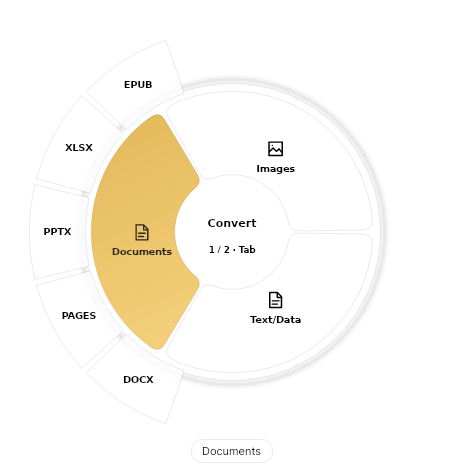
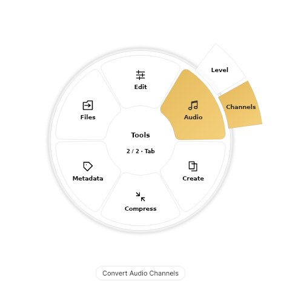
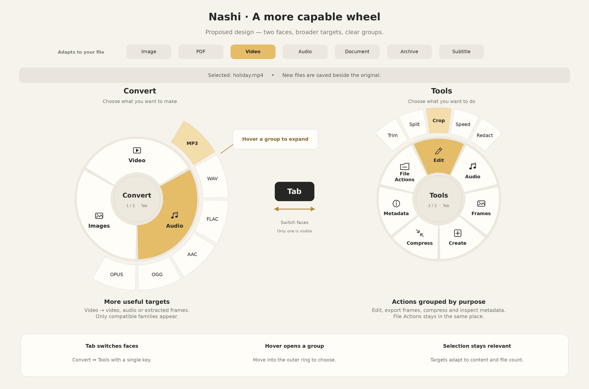
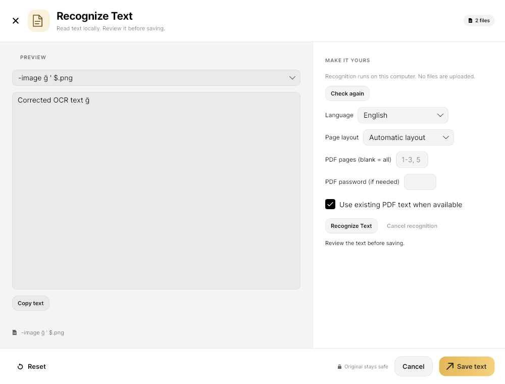
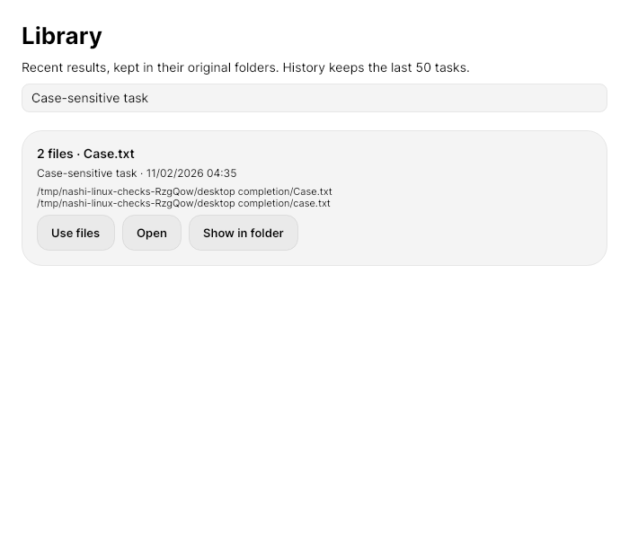
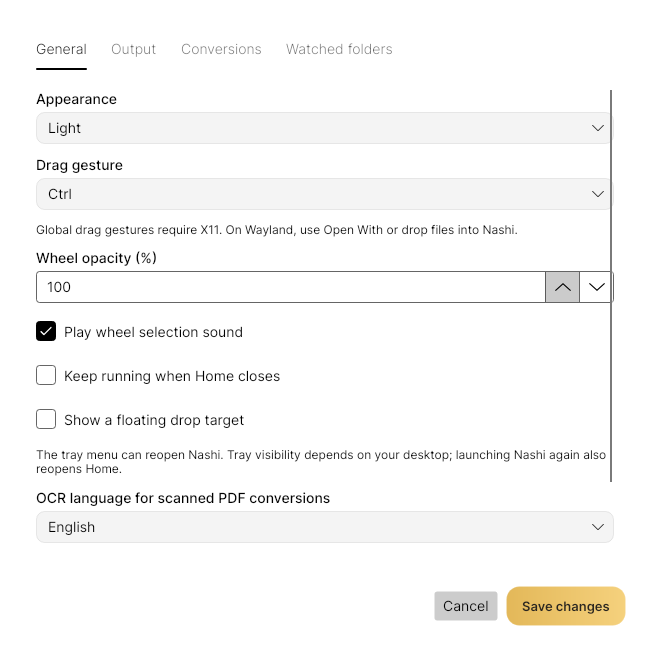

# Linux için Nashi

**Dosyaları tekerlek menüsünden dönüştürün, düzenleyin ve yönetin.**

Linux v1 önizleme · x86_64 AppImage · X11 önerilir

[Kurulum](#kurulum) · [Yetenekler](#neler-yapabilir) · [Linux ve macOS](#linux-ve-macos) · [Ayrıntılı rehber](GUIDE.tr.md) · [English](README.md)

> **İlk Linux sürümü — ayrıntılı testler devam ediyor.** Uygulama sürümü **0.7.14**; “Linux v1” ilk Linux sürümünü ifade eder. Dağıtım, masaüstü ve codec uyumluluğu hâlâ test ediliyor.

## İki yüz, tek akış

| Convert | Tools |
| :---: | :---: |
|  |  |
| Çıktı biçimini seçin. | Düzenleme veya dosya işlemini seçin. |

*Linux arayüz kontrollerinden örnek görüntüler: solda PDF, sağda medya seçimi. Görünen gruplar dosyaya göre değişir.*

**Tab** yüz değiştirir. Grubun üzerinde **beklemek** dış halkayı açar. Seçeneğe **tıklamak veya dosyayı bırakmak** işlemi başlatır ya da düzenleyiciyi açar. Tam işlem adı tekerleğin altında görünür.

Karışık seçimlerde ortak hedefler önce gösterilir. Görüntü ve PDF birlikte JPG yapılabilir. Yalnızca bazı dosyalara uygun hedeflerde kapsam altta **WEBP · 1 of 3 files** gibi belirtilir; yalnızca uygun dosyalar işlenir, orijinaller korunur.

<details>
<summary>İlk iki yüzlü tasarım planını göster</summary>



*Tasarım referansıdır; mevcut uygulamada başlıklar ve seçenekler değişebilir.*

</details>

## Kurulum

AppImage ve eşleşen `.sha256` dosyasını [Linux dosyalarını içeren bir yayından](https://github.com/orkunisitmak/nashi-app/releases) veya [Linux iş akışının](../.github/workflows/linux.yml) **Linux preview** çıktısından indirin. Henüz yayımlanmış Linux release dosyası olmayabilir. Önizleme paketleri imzasızdır.

```sh
sha256sum -c Nashi-Linux-x86_64.AppImage.sha256
chmod +x Nashi-Linux-x86_64.AppImage
./Nashi-Linux-x86_64.AppImage
```

.NET çalışma zamanı dahildir. FUSE nedeniyle açılmazsa `--appimage-extract-and-run` kullanın. Ubuntu 22.04'te normal çalıştırma için `libfuse2` kurulabilir.

### Ek araçlar

Görüntü ve PDF kitaplıkları pakete dahildir. Tam medya desteği için araç kurulumundaki sabitlenmiş FFmpeg 9 sürümünü kullanın; eski dağıtım paketlerinde gereken filtreler eksik olabilir. Örneğin Ubuntu 22.04’ün FFmpeg 4.4 sürümü güncel motorla kare çıkaramaz. Diğer araçlar yapacağınız işleme bağlıdır.

| Araç | Kullanım | Kurulum |
| --- | --- | --- |
| FFmpeg + ffprobe | Ses, video ve kare çıkarma | Uygulamadaki **Set up tools** veya sistem `ffmpeg` paketi |
| LibreOffice | Office ve belge dönüşümleri | Dağıtımın yerel paketi; Snap/Flatpak kullanılmaz |
| ExifTool + Perl | Görüntü/PDF metadata | ExifTool uygulamadan; `perl` sistemden |
| Deno | Pages dönüşümü | Uygulamanın araç kurulumu |
| Tesseract + dil paketleri | Görüntü/taranmış PDF metin tanıma | Sistemin `tesseract-ocr`, `tesseract-ocr-eng`, `tesseract-ocr-tur` paketleri |
| PulseAudio / PipeWire uyumluluğu | Önizleme ve geri bildirim sesi | Masaüstü ses hizmeti |

Ubuntu/Debian örneği: `sudo apt install ffmpeg libreoffice perl`. Ayrıntılar [kurulum rehberinde](GUIDE.tr.md#gereken-ek-araçlar).

### Masaüstünden kullanım

AppImage'ı kalıcı bir konuma taşıyıp çalıştırın:

```sh
./Nashi-Linux-x86_64.AppImage --install-integration
```

Oturum açılışında başlamayı, **X11'de Ctrl-sürüklemeyi** ve **Open With → Nashi** girdisini kurar. Nautilus Scripts menüsüne girdi eklemez; eski Nashi scriptlerini temizler.

Wayland'de uygulamayı veya Open With kullanın; global Ctrl-sürükleme yoktur. Uygulamada dosya seçin, sürükleyin veya kopyalanmış dosyaları **Ctrl+V** ile yapıştırın. **Ctrl+Space** tekerleği açar.

## Neler yapabilir?

| Dosyalar | Başlıca yetenekler |
| --- | --- |
| Görüntü | Dönüştürme, kırpma, boyutlandırma, döndürme, renk ayarları, anotasyon, karartma, arka plan, kolaj, sıkıştırma, metadata ve QR |
| PDF | JPG/PNG sayfalar, mevcut metni çıkarma, sayfa sıralama/bölme/birleştirme, sıkıştırma, metadata ve görüntülerden PDF |
| Belge ve veri | Uygun Office, Pages, EPUB, HTML, Markdown, metin ve tablo dönüşümleri |
| Video | Dönüştürme, kesme/bölme, kare kırpma, hız, karartma, sessize alma, birleştirme, sıkıştırma, ses ve kare çıkarma |
| Ses | Dönüştürme, kesme, ses yüksekliği normalleştirme, kanal ayarları, bipleme ve görselleştirme |
| Arşiv ve altyazı | ZIP/TAR/GZIP/RAR açma, desteklenen arşiv çıktıları ve SRT/VTT/metin dönüşümü |
| Dosya işlemleri ve Float | Kopyalama, taşıma, yol kopyalama, terminal, dosyayı gösterme ve referansları yüzen rafta tutma |

**OCR:** Tools → Read → OCR ile görüntü ve PDF sayfalarından yerelde metin tanınır. Türkçe/İngilizce ve yerleşim seçin; sonucu düzenleyip kopyalayın veya TXT kaydedin. Tesseract 5 önerilir; uyumlu Tesseract 4 LSTM kurulumları da desteklenir. [OCR kurulum ve sınırları](OCR-OPTIONS.md).

<details>
<summary>OCR düzenleyicisi önizlemesi</summary>



*Kontrol edilmiş metni ve tanıma seçeneklerini gösteren arayüz test görüntüsü.*

</details>

**Varsayılan olarak çıktılar orijinalin yanına kaydedilir.** İndirilenler'deki PDF'nin JPG sayfaları aynı klasöre gider. Orijinaller korunur; isim çakışırsa benzersiz ad kullanılır. Sonuç kartında **Show in folder** bulunur. Birleştirme ilk dosyanın yanına kaydeder; yazılamayan klasörde başka konum sorulur. Ayarlardan işlem başına klasör sorma veya sabit çıktı klasörü de seçilebilir.

[Biçim listesi ve araç ayrıntıları](GUIDE.tr.md#neler-yapabilir).

## Masaüstü akışları

- **Library:** son 50 tamamlanan işlemi arayın, sonuçları açın veya yeni seçimde kullanın. Dosyalar kendi klasörlerinde kalır; taşınan/silinen sonuçlar belirtilir.
- **Settings:** çıktı konumu, görünüm, X11 sürükleme tuşu, OCR dili ve biçim varsayılanlarını değiştirin. İzlenen klasörleri ekrandan yönetin.
- **Pano ve klasörler:** dosya/klasör, metin, PNG veya bağlantı yapıştırın. Bağlantı indirme ekranını açar; indirme düğmesine basılana kadar indirme yapılmaz. Klasörler dosyalarla ZIP'e eklenebilir, kopyalanabilir veya taşınabilir.
- **Arka plan:** tepsi menüsü Home ve Float'ı açar. İsteğe bağlı küçük bırakma penceresinde önce dosyayı bırakın, sonra tekerlekten işlem seçin. Gerçek Wayland oturumunda doğrulama sürüyor.

```sh
./Nashi-Linux-x86_64.AppImage convert /dosya/belge.pdf --to jpg
./Nashi-Linux-x86_64.AppImage ocr /dosya/tarama.pdf --language eng+tur
./Nashi-Linux-x86_64.AppImage --help
```

Entegrasyon, başka bir komutun üzerine yazmadan `~/.local/bin/nashi` başlatıcısını ekler. x64 DEB/RPM önizlemeleri de üretilebilir; paket yöneticisiyle kurulum henüz test edilmedi. [Taşınabilir paket](scripts/build-linux-portable.sh) önceki kurulumu yedekleyen isteğe bağlı kullanıcı kurucusu içerir. ARM64 doğrulama işi hazırlandı fakat henüz uzak CI'da çalışmadı; araç indirme x64 ile sınırlı.

<details>
<summary>Kitaplık ve Ayarlar önizlemeleri</summary>




</details>

## Linux ve macOS

Tablo mevcut depo uygulamalarını karşılaştırır. Benzer araçlar, tüm işlevlerin ve sistem davranışlarının eşit olduğu anlamına gelmez.

| Alan | Linux v1 önizleme | macOS |
| --- | --- | --- |
| Uygulama | .NET / Avalonia, AppImage | Yerel Swift / AppKit |
| Sürükleme | X11'de Ctrl, Tab ile iki yüz; Wayland'de uygulama/Open With veya isteğe bağlı bırakma penceresi | Dönüştürme, araç ve işlemler için ayarlanabilir yerel sürükleme kısayolları |
| Görüntü düzenleme | Temel araçlar; HEIC okuma ve FFmpeg ile HEIC çıktısı | Temel araçlar ve HEIC çıktısı |
| Otomatik algılama | Yerel OCR ile kontrol edilebilir metin bölgeleri; düz arka plan kaldırma; yüz algılama yok | Karartmada Vision ile yüz/metin algılama |
| Taranmış PDF | Yerel Tesseract OCR; kontrol edilebilir TXT ve taranmış sayfadan otomatik metin/belge dönüşümü | Vision OCR ile taranmış sayfadan metin |
| Belge araçları | Sistem LibreOffice ve Pages için Deno; daha az seçenek kontrolü | İsteğe bağlı Office çalışma zamanı, yerel PDF işleme, yerleşim/parola seçenekleri |
| HTML → PDF | LibreOffice ile temizlenmiş HTML; betik çalışmaz | WebKit; uzak kaynaklar engellenirken betikle çizilen yerel içerik desteklenir |
| Medya | FFmpeg tabanlı dönüşüm, düzenleme ve önizleme | Yerel sistem oynatımıyla medya araçları |
| Kitaplık ve genel önizleme | Kalıcı aranabilir işlem geçmişi, tekrar kullanım, dış uygulamada açma; genel toplu önizleme yok | Kalıcı Kitaplık ve dosya/toplu önizleme |
| Pano | Dosya/klasör, özel metin/PNG içe aktarımı ve indirme ekranına bağlantı | Dosya/klasör, metin, görüntü ve bağlantı |
| Web indirme | Video, ses, görüntü, fotoğraf ve küçük resim için bağlantı indirme ekranı | Ayrı genel bağlantı indirme akışı |
| Paylaşım | Dosya yöneticisinde gösterir | Yerel paylaşım ve AirDrop |
| Pencere yerleşimi | Yok | Sürüklemeyle pencere düzenleri |
| Ayarlar ve güncelleme | Ayar ekranı, biçim varsayılanları, izlenen klasörler ve tepsi; otomatik güncelleme yok | Ayar ekranı ve Sparkle güncellemeleri |

Diğer masaüstü sürümleri için [macOS/Windows karşılaştırmasına](../docs/DESKTOP-PARITY.md) bakabilirsiniz.

## Durum ve doğrulama

Geliştirme ve gerçek sürükle-bırak kontrolleri **Ubuntu 22.04.5 / X11** üzerinde yapıldı. Gerçek dosya, codec ve masaüstü testleri sürüyor.

2026-11-02 yerel doğrulamasında sabitlenmiş FFmpeg 9, Deno ve ExifTool ile sistem LibreOffice kullanılarak **4.878 Linux kontrolü** ve **gerçek medya işlemleri dahil 2.285 ortak motor kontrolü** geçti. Pages dahil **380 dönüşüm yolunun tamamı** ve metadata tur testi çalıştırıldı. X11 testi PDF → JPG sürükle-bırak işlemini, çıktı konumunu ve kaynağın değişmediğini kontrol eder. İlk koşudaki hover zaman aşımının ardından, son üçü art arda olmak üzere dört tekrar geçti; aralıklı hatanın nedeni henüz kesinleşmedi. Bunlar her dosya ve dağıtımla uyumluluk garantisi değildir.

[Derleme ve testler](GUIDE.tr.md#kaynaktan-derleme-ve-kontroller) · [Eksikler](GUIDE.tr.md#eksikler-ve-test-durumu) · [Entegrasyon ve tercihler](GUIDE.tr.md#masaüstü-entegrasyonu)

Sorun bildirirken sürümü, dağıtımı, X11/Wayland oturumunu, kaynak/hedef türünü ve hata mesajını ekleyin.
